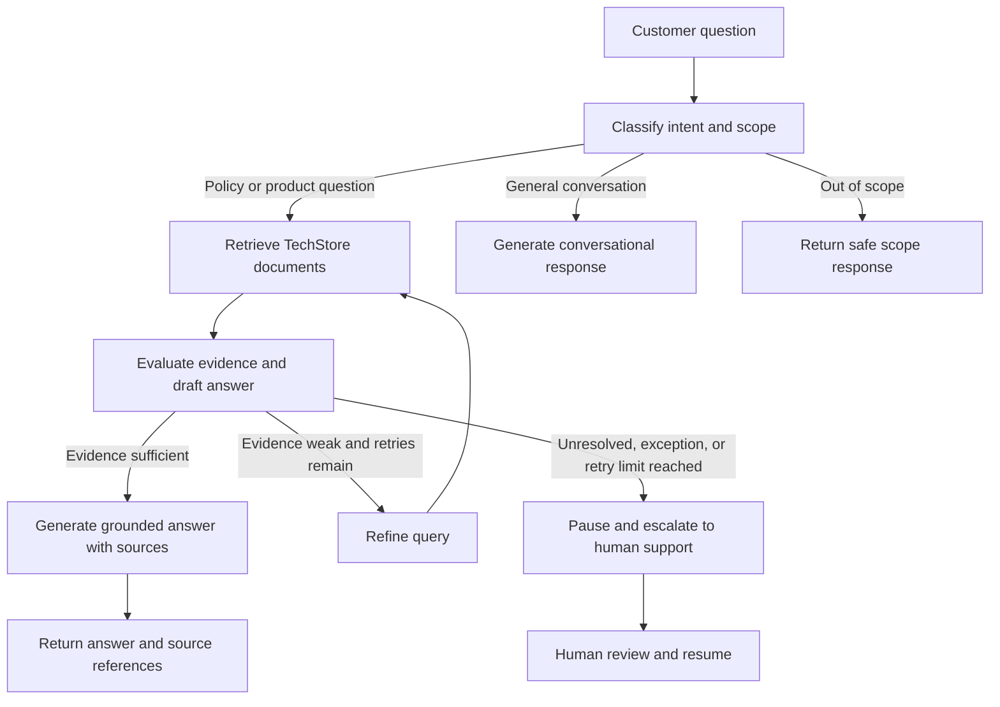

# TechStore Agentic RAG Customer Support

TechStore is a fictional online electronics store. This project will build an Agentic Retrieval-Augmented Generation (RAG) assistant that answers customer questions using TechStore's policies, FAQs, product catalog, and troubleshooting guide.

The system is planned in Python with LangChain and LangGraph. It will classify and route customer requests, retrieve relevant company information, evaluate answer quality, retry weak retrieval within a limit, and escalate unresolved cases to human support.

> **Project status:** Planning and setup. The application source code, environment file, provider configuration, vector store, and runnable UI have not been added yet. Do not expect an application run command to work until those components are implemented.

## Project Scope

The assistant is intended to answer questions about:

- Orders, tracking, cancellation, and changes.
- Payments and failed or duplicate charges.
- Shipping, delays, lost or damaged deliveries.
- Returns, refunds, and warranty coverage.
- Product specifications, availability, and compatibility.
- Common troubleshooting steps.

The assistant should cite relevant TechStore sources, say when the knowledge base does not contain enough evidence, and escalate unresolved complaints, policy exceptions, and other cases requiring human support.

## Data Sources

### TechStore Knowledge Base

The team will write these fictional documents. They are the authoritative source for company policies and product answers:

1. Return Policy
2. Refund Policy
3. Shipping Policy
4. Warranty Policy
5. Payment Policy
6. Order Management
7. Customer FAQ
8. Escalation Policy
9. Product Catalog
10. Troubleshooting Guide

These documents should be internally consistent and include useful source metadata, such as document title, section, version, and source type.

### Bitext Customer Support Dataset

Source: [Bitext Customer Support Dataset on Hugging Face](https://huggingface.co/datasets/bitext/Bitext-customer-support-llm-chatbot-training-dataset)

The dataset contains synthetic customer-support examples. The project will use its instructions, categories, intents, responses, and flags for intent examples, routing tests, and evaluation cases.

**Bitext is not genuine TechStore conversation history and is not the authority for TechStore policies.** Company-policy answers must be grounded in the fictional TechStore knowledge base. Verify the dataset's license and usage conditions before redistributing it.

## Planned Workflow



This is the intended design, not a description of already implemented behavior. LangGraph will manage the state, conditional routes, bounded retry cycle, and human-in-the-loop checkpoint/resume flow.

## Repository Documentation

- [Project instructions](DOCS/instructions/PROJECT_INSTRUCTIONS.md)
- [Team task division and checkpoints](DOCS/planning/TEAM_TASK_DIVISION.md)
- [Course project specification](DOCS/requirements/Agentic%20RAG%20System%20Project.pdf)

## Development Environment

The team plans to use **Miniconda/Conda**, not `venv`. Install Miniconda first if Conda is not available, then create and activate a project environment:

```bash
conda create --name techstore-rag python=3.11 pip
conda activate techstore-rag
python -m pip install langchain langgraph
```

Python 3.11 is the initial target; confirm compatibility with the final model provider, vector-store, and UI dependencies before locking versions. The current repository does not yet include an `environment.yml` or application dependency lock file. Add and maintain one after the team selects the remaining dependencies.

In VS Code, select the `techstore-rag` Conda interpreter for this workspace. Do not commit Conda environments, virtual-environment folders, or credentials.

### Environment Variables

The LLM provider and required settings have not been selected yet. Once selected:

- Document the variable names and non-secret defaults here.
- Add placeholders (never real credentials) to `.env.example`.
- Read API keys and sensitive settings from environment variables.
- Do not print secrets or customer data in logs.

## Running the Application

There is no application entry point yet, so there is no run command at this stage. Add the verified launch command here when the UI and backend are implemented. Never document a mock as real LLM or retrieval behavior; label development mocks explicitly.

## Evaluation Plan

The team plans to evaluate:

- Intent and route accuracy using held-out synthetic examples and team-authored cases.
- Retrieval relevance against expected TechStore source documents.
- Answer faithfulness and groundedness against policy and product documents.
- Retry and human-escalation behavior, including the maximum retry limit.
- Latency across routing paths and end-to-end workflows.

Document the evaluation method and actual measured results. Do not invent scores or present Bitext responses as company-policy ground truth.

## Security and Privacy

- Never hardcode or expose credentials.
- Validate customer input and treat retrieved documents as untrusted content, not instructions.
- Enforce access controls before retrieving or returning internal information.
- Collect only necessary personal information and mask sensitive values in logs.
- Use synthetic or properly anonymized data for development and evaluation.
- Escalate when evidence is insufficient; do not invent policies, product details, prices, or customer/order information.

## Team

- **Seif:** Team leader; coordinates decisions, progress, and integration.
- **Mohamed:** Priority owner for core RAG, retrieval, and LangGraph workflow implementation.
- **Abdullah:** Data preparation, policy content, retrieval testing, and evaluation.
- **Ahmed:** Model integration, product and payment content, HITL, interface, setup, and testing.

All members should contribute using their personal GitHub accounts, work through feature branches and pull requests, review teammates' work, and keep the contribution record accurate.
